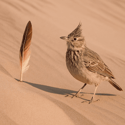

# Request-ImageEdit

## SYNOPSIS
Creates an edited or extended image given an original image and a prompt.

## SYNTAX

```
Request-ImageEdit
    -Image <String[]>
    -Prompt <String>
    [-Model <String>]
    [-Mask <String>]
    [-NumberOfImages <UInt16>]
    [-Size <String>]
    [-Quality <String>]
    [-Complexity <String>]
    [-Background <String>]
    [-InputFidelity <String>]
    [-OutputCompression <UInt16>]
    [-OutputFormat <String>]
    [-FrameCount <Int32>]
    [-FrameDurationMs <Int32>]
    [-ResponseFormat <String>]
    [-OutputRawResponse]
    [-Stream]
    [-PartialImages <UInt16>]
    [-User <String>]
    [-TimeoutSec <Int32>]
    [-MaxRetryCount <Int32>]
    [-ApiBase <Uri>]
    [-ApiKey <Object>]
    [-Organization <String>]
    [<CommonParameters>]
```

```
Request-ImageEdit
    -Image <String[]>
    -Prompt <String>
    -OutFile <String>
    [-Model <String>]
    [-Mask <String>]
    [-NumberOfImages <UInt16>]
    [-Size <String>]
    [-Quality <String>]
    [-Complexity <String>]
    [-Background <String>]
    [-InputFidelity <String>]
    [-OutputCompression <UInt16>]
    [-OutputFormat <String>]
    [-FrameCount <Int32>]
    [-FrameDurationMs <Int32>]
    [-Stream]
    [-PartialImages <UInt16>]
    [-User <String>]
    [-TimeoutSec <Int32>]
    [-MaxRetryCount <Int32>]
    [-ApiBase <Uri>]
    [-ApiKey <Object>]
    [<CommonParameters>]
```

## DESCRIPTION
Creates an edited or extended image given an original image and a prompt.  
https://developers.openai.com/api/reference/resources/images/methods/edit

## EXAMPLES

### Example 1: Edit an image with a prompt.
```PowerShell
Request-ImageEdit -Model 'gpt-image-2' -Prompt 'A bird on the desert' -Image 'C:\sand_with_fether.png' -OutFile 'C:\bird_on_desert.png' -Size 1024x1024
```

| Original                                        | Generated                                  |
| ----------------------------------------------- | ------------------------------------------ |
|  |  |


### Example 2: Edit an image using a source and mask.
```PowerShell
Request-ImageEdit -Model 'gpt-image-2' -Image C:\sand_with_feather.png -Mask C:\fether_mask.png -Prompt "A bird on the desert" -OutFile C:\edit2.png
```

| Source (sand_with_feather.png)                | Mask (fether_mask.png)                | Generated (edit2.png)               |
| --------------------------------------------- | ------------------------------------- | ----------------------------------- |
|  |  |  |


### Example 3: Edit using multiple source images.
```PowerShell
Request-ImageEdit -Model 'gpt-image-2' -Image @('C:\sand_with_feather.png', 'C:\fether_mask.png') -Prompt 'Use both images as references for a new scene' -OutFile 'C:\combined.png'
```


### Example 4: Control edit planning with GPT Image 2.6.
```PowerShell
Request-ImageEdit -Model 'gpt-image-2.6-flare' -Image C:\sand_with_feather.png -Prompt 'Make the feather blue' -Complexity low -Quality low -OutFile C:\blue-feather.png
```

## PARAMETERS

### -Image
(Required)
The image(s) to edit. Must be a supported image file or an array of images. For the GPT image models, each image should be a `png`, `webp`, or `jpg` file less than 50MB. You can provide up to 16 images.

```yaml
Type: String[]
Aliases: File
Required: True
Position: Named
```

### -Prompt
(Required)
A text description of the desired image(s). The maximum length is 32000 characters for the GPT image models.

```yaml
Type: String
Required: True
Position: Named
```

### -Mask
An additional image whose fully transparent areas (e.g. where alpha is zero) indicate where image should be edited. If there are multiple images provided, the mask will be applied on the first image. Must be a valid PNG file, less than 4MB, and have the same dimensions as image.

```yaml
Type: String
Required: False
Position: Named
```

### -Model
The model to use for image editing. Defaults to `gpt-image-2`. Supports `gpt-image-2.6-sunburst` and `gpt-image-2.6-flare`, as well as GPT Image 2.5 and earlier models subject to API availability. Model names and Azure deployment names are not restricted to the completion suggestions.

```yaml
Type: String
Required: False
Position: Named
```

### -NumberOfImages
The number of images to generate. Must be between 1 and 10.

```yaml
Type: UInt16
Aliases: n
Required: False
Position: Named
Default value: 1
```

### -Quality
The quality of the image that will be generated.  
- `auto` (default value) will automatically select the best quality for the given model.
- `max`, `xhigh`, `high`, `medium`, and `low` are accepted subject to model support.

```yaml
Type: String
Required: False
Position: Named
Default value: auto
```

### -Complexity
Computation spent planning the edit, independently of rendering `Quality`. Accepts `low`, `medium`, or `high` on GPT Image 2.6. Omitted values use the image model's configured default.

```yaml
Type: String
Required: False
Position: Named
```

### -Size
The size of the generated images. GPT Image 2, 2.5, and 2.6 accept supported `WIDTHxHEIGHT` resolutions or `auto`. Older image models support their documented fixed sizes.

```yaml
Type: String
Required: False
Position: Named
Default value: auto
```

### -Background
Background behavior for generated image output.  
Accepts one of the following: `transparent`, `opaque`, and `auto` (default).
```yaml
Type: String
Required: False
Position: Named
Default value: auto
```

### -InputFidelity
Controls fidelity to the original input image(s).
This parameter is only supported for `gpt-image-1` and `gpt-image-2` and later models, unsupported for `gpt-image-1-mini`. Supports `high` and `low`. Defaults to `low`.
```yaml
Type: String
Aliases: input_fidelity
Required: False
Position: Named
Default value: low
```

### -OutputCompression
The compression level (0-100%) for the generated images. This parameter is only supported for the GPT image models with the `webp` or `jpeg` output formats, and defaults to 100.
```yaml
Type: UInt16
Aliases: output_compression
Required: False
Position: Named
Default value: 100
```

### -OutputFormat
The output format for GPT image models: `png`, `jpeg`, `webp`, or `gif`, subject to endpoint and account support. Defaults to `png` unless inferred from `OutFile`. An explicit value overrides the extension. SVG editing is not supported.

The API schema and official SDK expose GIF edit controls, but the image generation guide currently documents GIF output as generation-only. These parameters are forwarded for endpoints with GIF edit support; acceptance is determined by the API. GIF output does not support masks, streaming, partial images, or custom output compression.
```yaml
Type: String
Aliases: output_format
Required: False
Position: Named
Default value: png
```

### -FrameCount
Number of GIF frames, from 2 through 16 according to the API schema. Use only with GIF output on an endpoint that supports GIF edits. If omitted, the API defaults to 9. Model-specific pixel limits also apply.

```yaml
Type: Int32
Aliases: frame_count
Required: False
Position: Named
```

### -FrameDurationMs
Requested delay per GIF frame in milliseconds, at least 20. Use only with GIF output on an endpoint that supports GIF edits. If omitted, the API defaults to 200. The Images API rounds to 10 ms and caps the encoded delay at 655,350 ms.

```yaml
Type: Int32
Aliases: frame_duration_ms
Required: False
Position: Named
```

### -ResponseFormat
How to return the result: `url`, `base64`, `byte`, or `object`. GPT image models always return base64 data from the API; this command can decode it to bytes or return the full response object. For GPT image models, the default `url` selection falls back to `object`.

```yaml
Type: String
Parameter Sets: Format
Aliases: response_format
Required: False
Position: Named
Default value: url
```

### -OutputRawResponse
If specifies this switch, an output of this function to be a raw response value from the API. (Normally JSON formatted string.)

```yaml
Type: SwitchParameter
Parameter Sets: Format
Required: False
Position: Named
```

### -OutFile
Specify the file path where the generated images will be saved. This cannot be specified with the `ResponseFormat` parameter. For GPT image models, `.png`, `.jpg`, `.jpeg`, `.webp`, and `.gif` extensions select the output format unless `OutputFormat` is explicitly supplied. Unrecognized extensions use PNG.

```yaml
Type: String
Parameter Sets: OutFile
Required: True
Position: Named
```

### -Stream
Edit the image in streaming mode. Defaults to `false`.
```yaml
Type: SwitchParameter
Required: False
Position: Named
```

### -PartialImages
The number of partial images to generate. This parameter is used for streaming responses that return partial images. Value must be between 0 and 3. When set to 0, the response will be a single image sent in one streaming event.
```yaml
Type: UInt16
Required: False
Position: Named
Default value: 0
```

### -User
A unique identifier representing your end-user, which can help OpenAI to monitor and detect abuse.

```yaml
Type: String
Required: False
Position: Named
```

### -TimeoutSec
Specifies how long the request can be pending before it times out.
The default value is `0` (infinite).

```yaml
Type: Int32
Required: False
Position: Named
Default value: 0
```

### -MaxRetryCount
Number between `0` and `100`.  
Specifies the maximum number of retries if the request fails.  
The default value is `0` (No retry).  
Note : Retries will only be performed if the request fails with a `429 (Rate limit reached)` or `5xx (Server side errors)` error. Other errors (e.g., authentication failure) will not be performed.  

```yaml
Type: Int32
Required: False
Position: Named
Default value: 0
```

### -ApiBase
Specifies an API endpoint URL such like: `https://your-api-endpoint.test/v1`  
If not specified, it will use `https://api.openai.com/v1`

```yaml
Type: System.Uri
Required: False
Position: Named
Default value: https://api.openai.com/v1
```

### -ApiKey
Specifies API key for authentication.  
The type of data should `[string]` or `[securestring]`.  
If not specified, it will try to use `$global:OPENAI_API_KEY` or `$env:OPENAI_API_KEY`

```yaml
Type: Object
Required: False
Position: Named
```

### -Organization
Specifies Organization ID which used for an API request.  
If not specified, it will try to use `$global:OPENAI_ORGANIZATION` or `$env:OPENAI_ORGANIZATION`

```yaml
Type: string
Aliases: OrgId
Required: False
Position: Named
```

## INPUTS

## OUTPUTS

## NOTES

## RELATED LINKS

[https://developers.openai.com/api/docs/guides/image-generation/](https://developers.openai.com/api/docs/guides/image-generation/)

[https://developers.openai.com/api/reference/resources/images/methods/edit](https://developers.openai.com/api/reference/resources/images/methods/edit)
