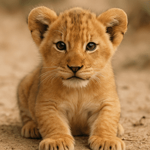

# Request-ImageGeneration

## SYNOPSIS
Creates an image given a prompt.

## SYNTAX

```
Request-ImageGeneration
    [-Prompt] <String>
    [-Model <String>]
    [-NumberOfImages <UInt16>]
    [-Size <String>]
    [-Quality <String>]
    [-Complexity <String>]
    [-Style <String>]
    [-Background <String>]
    [-Moderation <String>]
    [-OutputCompression <UInt16>]
    [-OutputFormat <String>]
    [-FrameCount <Int32>]
    [-FrameDurationMs <Int32>]
    [-SvgModel <String>]
    [-SvgReasoningEffort <String>]
    [-ResponseFormat <String>]
    [-OutputRawResponse]
    [-User <String>]
    [-TimeoutSec <Int32>]
    [-MaxRetryCount <Int32>]
    [-ApiBase <Uri>]
    [-ApiKey <Object>]
    [-Organization <String>]
    [<CommonParameters>]
```

```
Request-ImageGeneration
    [-Prompt] <String>
    -OutFile <String>
    [-Model <String>]
    [-NumberOfImages <UInt16>]
    [-Size <String>]
    [-Quality <String>]
    [-Complexity <String>]
    [-Style <String>]
    [-Background <String>]
    [-Moderation <String>]
    [-OutputCompression <UInt16>]
    [-OutputFormat <String>]
    [-FrameCount <Int32>]
    [-FrameDurationMs <Int32>]
    [-SvgModel <String>]
    [-SvgReasoningEffort <String>]
    [-User <String>]
    [-TimeoutSec <Int32>]
    [-MaxRetryCount <Int32>]
    [-ApiBase <Uri>]
    [-ApiKey <Object>]
    [-Organization <String>]
    [<CommonParameters>]
```

## DESCRIPTION
Creates an image given a prompt.  
https://developers.openai.com/api/reference/resources/images/methods/generate

## EXAMPLES

### Example 1: Creates and save an image from prompt. 
```PowerShell
Request-ImageGeneration -Model 'gpt-image-2' -Prompt 'A cute baby lion' -OutFile C:\babylion.png
```




### Example 2: Creates multiple images at once, and retrieve results by URL.
```PowerShell
Request-ImageGeneration -Model 'dall-e-3' -Prompt 'Delicious ramen with gyoza' -Model -ResponseFormat 'url' -NumberOfImages 3
```
```
https://oaidalleapiprodscus.blob.core.windows.net/private/org-BXLtGIt0xglP9if8FVhkD...
https://oaidalleapiprodscus.blob.core.windows.net/private/org-BXLtGIt0xglP9if8FVhkD...
https://oaidalleapiprodscus.blob.core.windows.net/private/org-BXLtGIt0xglP9if8FVhkD...
```

### Example 3: Generate an animated GIF with GPT Image 2.6.
```PowerShell
Request-ImageGeneration -Model 'gpt-image-2.6-flare' -Prompt 'A bouncing blue ball, seamless loop' -Complexity low -Quality low -Size 512x512 -FrameCount 2 -FrameDurationMs 200 -OutFile C:\ball.gif
```

The file extension selects GIF output. Availability depends on GIF preview access for the selected model.

### Example 4: Generate an SVG with GPT Image 2.6.
```PowerShell
Request-ImageGeneration -Model 'gpt-image-2.6-sunburst' -Prompt 'A simple mountain icon' -Complexity low -Quality low -SvgModel 'gpt-6-luna' -SvgReasoningEffort low -OutFile C:\mountain.svg
```

This example requires SVG model selection and access to the specified author model. If SVG model selection is disabled for your account, omit `-SvgModel` and `-SvgReasoningEffort` to use the API's default author. With object output, `svg_usage` reports author token usage separately from image `usage`.

## PARAMETERS

### -Prompt
(Required)
A text description of the desired image(s). The maximum length is 32000 characters for the GPT image models, 1000 characters for `dall-e-2` and 4000 characters for `dall-e-3`.

```yaml
Type: String
Required: True
Position: 1
Accept pipeline input: True (ByValue)
```

### -Model
The model to use for image generation. Defaults to `gpt-image-2`. Supports `gpt-image-2.6-sunburst` and `gpt-image-2.6-flare`, as well as GPT Image 2.5 and earlier models subject to API availability. Model names and Azure deployment names are not restricted to the completion suggestions.

```yaml
Type: String
Required: False
Position: Named
Default value: gpt-image-2
```

### -NumberOfImages
The number of images to generate. Must be between 1 and 10. For `dall-e-3`, only `1` is supported.

```yaml
Type: UInt16
Aliases: n
Required: False
Position: Named
Default value: 1
```

### -Size
The size of the generated images. GPT Image 2, 2.5, and 2.6 accept supported `WIDTHxHEIGHT` resolutions or `auto`. GIF sizes must also satisfy the selected model's frame and pixel limits. Older image models support their documented fixed sizes.

```yaml
Type: String
Required: False
Position: Named
Default value: auto
```

### -Quality
The quality of the image that will be generated.  
- `auto` (default value) will automatically select the best quality for the given model.
- `max`, `xhigh`, `high`, `medium`, and `low` are accepted subject to model support.

```yaml
Type: String
Required: False
Position: Named
Default value: auto
```

### -Complexity
Computation spent planning the image, independently of rendering `Quality`. Accepts `low`, `medium`, or `high` on GPT Image 2.6. Omitted values use the image model's configured default. For SVG output this controls the reference image, independently of the SVG author's reasoning.

```yaml
Type: String
Required: False
Position: Named
```

### -Style
The style of the generated images. Must be one of `vivid` or `natural`. Vivid causes the model to lean towards generating hyper-real and dramatic images. Natural causes the model to produce more natural, less hyper-real looking images. This param is only supported for `dall-e-3`.

```yaml
Type: String
Required: False
Position: Named
Default value: vivid
```

### -Background
Allows to set transparency for the background of the generated image(s). This parameter is only supported for the GPT image models. Must be one of `transparent`, `opaque` or `auto` (default value). When `auto` is used, the model will automatically determine the best background for the image.

```yaml
Type: String
Required: False
Position: Named
```

### -Moderation
Control the content-moderation level for images generated by the GPT image models. Must be either `low` for less restrictive filtering or `auto` (default value).

```yaml
Type: String
Required: False
Position: Named
```

### -OutputCompression
The compression level (0-100%) for the generated images. This parameter is only supported for the GPT image models with the `webp` or `jpeg` output formats, and defaults to 100.

```yaml
Type: UInt16
Aliases: output_compression
Required: False
Position: Named
```

### -OutputFormat
The output file format for GPT image models: `png`, `jpeg`, `webp`, `gif`, or `svg`, subject to model and account support. Defaults to `png` unless inferred from `OutFile`. An explicit value overrides the file extension.

GIF output requires GIF preview access and does not support `Stream`, `PartialImages`, or `OutputCompression`. SVG output requires a single image and does not support `Stream`, `PartialImages`, or `OutputCompression`. Both formats are returned in `b64_json`; SVG content decodes to UTF-8 XML bytes.

```yaml
Type: String
Aliases: output_format
Required: False
Position: Named
```

### -FrameCount
Number of GIF frames, from 2 through 16 according to the API schema. Use only with GIF output. If omitted, the API defaults to 9. Model-specific pixel limits also apply.

```yaml
Type: Int32
Aliases: frame_count
Required: False
Position: Named
```

### -FrameDurationMs
Requested delay per GIF frame in milliseconds, at least 20. Use only with GIF output. If omitted, the API defaults to 200. The Images API rounds to 10 ms and caps the encoded delay at 655,350 ms; this differs from the Responses tool's 2000 ms maximum.

```yaml
Type: Int32
Aliases: frame_duration_ms
Required: False
Position: Named
```

### -SvgModel
The model used to author SVG output, for example `gpt-6-luna`. Requires SVG output and access to SVG model selection. When selection is enabled, specify this parameter; otherwise omit both SVG author parameters. The top-level `Model` still selects the image model that creates the reference image.

```yaml
Type: String
Required: False
Position: Named
```

### -SvgReasoningEffort
Reasoning effort for the SVG author, independently of image `Complexity`. Suggested values are `none`, `minimal`, `low`, `medium`, `high`, `xhigh`, and `max`; support depends on the author model. Requires SVG output and access to SVG model selection. Use with `SvgModel`. Omit this parameter to use the author's default; no reasoning settings are sent when omitted.

```yaml
Type: String
Required: False
Position: Named
```

### -ResponseFormat
How to return the result: `url`, `base64`, `byte`, or `object`. GPT image models always return base64 data from the API; this command can decode it to bytes or return the full response object, including `usage` and `svg_usage` when present. For GPT image models, the default `url` selection falls back to `object`.

```yaml
Type: String
Parameter Sets: Format
Aliases: response_format
Required: False
Position: Named
Default value: url
```

### -OutputRawResponse
If specifies this switch, an output of this function to be a raw response value from the API. (Normally JSON formatted string.)

```yaml
Type: SwitchParameter
Parameter Sets: Format
Required: False
Position: Named
```

### -OutFile
Specify the file path where the generated images will be saved. This cannot be specified with the `ResponseFormat` parameter. For GPT image models, `.png`, `.jpg`, `.jpeg`, `.webp`, `.gif`, and `.svg` extensions select the output format unless `OutputFormat` is explicitly supplied. Unrecognized extensions use PNG.

```yaml
Type: String
Parameter Sets: OutFile
Required: True
Position: Named
```

### -User
A unique identifier representing your end-user, which can help OpenAI to monitor and detect abuse.

```yaml
Type: String
Required: False
Position: Named
```

### -TimeoutSec
Specifies how long the request can be pending before it times out.
The default value is `0` (infinite).

```yaml
Type: Int32
Required: False
Position: Named
Default value: 0
```

### -MaxRetryCount
Number between `0` and `100`.  
Specifies the maximum number of retries if the request fails.  
The default value is `0` (No retry).  
Note : Retries will only be performed if the request fails with a `429 (Rate limit reached)` or `5xx (Server side errors)` error. Other errors (e.g., authentication failure) will not be performed.  

```yaml
Type: Int32
Required: False
Position: Named
Default value: 0
```

### -ApiBase
Specifies an API endpoint URL such like: `https://your-api-endpoint.test/v1`  
If not specified, it will use `https://api.openai.com/v1`

```yaml
Type: System.Uri
Required: False
Position: Named
Default value: https://api.openai.com/v1
```

### -ApiKey
Specifies API key for authentication.  
The type of data should `[string]` or `[securestring]`.  
If not specified, it will try to use `$global:OPENAI_API_KEY` or `$env:OPENAI_API_KEY`

```yaml
Type: Object
Required: False
Position: Named
```

### -Organization
Specifies Organization ID which used for an API request.  
If not specified, it will try to use `$global:OPENAI_ORGANIZATION` or `$env:OPENAI_ORGANIZATION`

```yaml
Type: string
Aliases: OrgId
Required: False
Position: Named
```

## INPUTS

## OUTPUTS

## NOTES

## RELATED LINKS

[https://developers.openai.com/api/docs/guides/image-generation/](https://developers.openai.com/api/docs/guides/image-generation/)

[https://developers.openai.com/api/reference/resources/images/methods/generate](https://developers.openai.com/api/reference/resources/images/methods/generate)
